# 🏠 Hierarchical Multi-Agent AI Heating Control (Home Assistant)

An experimental, physics-aware **Building Management System (BMS)** built on top of Home Assistant for a **1958 hydronic radiator house**. Instead of relying on static schedules or basic thermostats, this system combines real-time **PID valve control with mechanical deadband compensation**, **empirically measured thermal lag and radiator water-mass models**, a **hierarchical multi-agent AI supervisor** running on local Apple Silicon inference, and a **closed-loop offline statistical log cruncher (20x/day)** that continuously refines and deploys long-term room profiles[cite: 6].

## 🧠 System & Compute Architecture (Block Diagram)

```mermaid
flowchart TD
    subgraph HA_HOST ["🖥️ Home Assistant Host (Intel Core i7-7700 / 32 GB RAM)"]
        subgraph SENSORS ["1. Telemetry, Boiler & Diagnostics Layer"]
            S1["🌡️ Multi-Point Room & Reference Sensors<br/>(Living Room 3-zone, Hallway, Bedroom, Office)"]
            S2["🔧 Radiator Valve Body Temps & Window Sensors<br/>(Hydronic Loop & Ventilation State)"]
            S3["🔥 Boiler Loop & DHW Telemetry<br/>(Primary Supply/Return ΔT & Hot Water Tank)"]
            S4["🌤️ Outdoor Temp, Hourly Weather Forecast & Solar<br/>(Feedforward Heat-Gain & Frost Compensation)"]
            S5["📊 4h Digest + 26h Hybrid CSV Pipeline<br/>(15-min -26h..-6h + 5-min last 6h + On-Demand TRV Diag)"]
        end

        subgraph OFFLINE ["5. Offline Closed-Loop Learning Layer (20x/day)"]
            CRUNCH["🧮 pid_log_cruncher.py (Every 72 min)<br/>(24h RMSE, Swing, Radiator Inventory & Error Analytics)"]
            PROF["📁 learned_pid_profiles.json<br/>(Stateful Long-Term Memory & Profile Proposals)"]
        end

        subgraph SUPERVISOR ["2. Orchestration Layer (AI House Supervisor)"]
            SUP["🎩 AI House Supervisor (10-min cycle)<br/>(Audits 4h Digest, Boiler ΔT, Forecast & Learned Profiles)"]
            PHYS["📐 Empirical Physics & Radiator Mass Model<br/>• Steady-state lag: LR/Hall 5–10m | Bed 10–15m | Office 20–25m<br/>• Cold-start multiplier: 1.75–2.0x (cold pipe / ΔT ≥ 0.4°C)<br/>• 1958 Type 10/20/30 water-volume thermal inertia"]
            BOOST["🔥 Emergency Cross-Zone Boost Logic<br/>(Uses central Hallway/LR only when deficit ≥ 0.60°C)"]
        end

        subgraph GUARDS ["3. Zone Agent Layer (Dual-Path Execution)"]
            G1["🛋️ Living Room Guard<br/>(3-radiator shared PID + individual I-memories)"]
            G2["🚪 Hallway Guard<br/>(Central corridor & front-door spike filter)"]
            G3["🛏️ Bedroom Guard<br/>(Night-quiet & occupancy load profile)"]
            G4["🖥️ Office Guard<br/>(Long-loop & workstation power-aware)"]
        end

        subgraph CONTROL ["4. Real-Time Actuation & Safety Layer"]
            PID["⚙️ Zone PID Controllers<br/>(Kp, Ki, Kd, Bounded I-Memory, 1958 Valve Deadband)"]
            TRV["🚰 Shelly BLU TRV Radiator Valves<br/>(0–100% Positioning + 48h/25%-Battery Safe Calibration)"]
        end
    end

    subgraph OLLAMA_HOST ["🍎 Local AI Inference Node (Apple Mac mini M1 / 16 GB Unified RAM)"]
        OLLAMA["🦙 Ollama Local LLM Engine<br/>(Supervisor & Anomaly-Driven Zone Reasoning)"]
    end

    subgraph CLOUD_FREE ["☁️ Google Gemini Free Tier (20 runs/day)"]
        GEMINI["✨ Gemini 2.5 Flash<br/>(Offline 24h physics-aware profile refinement)"]
    end

    S1 & S2 & S3 & S4 --> S5
    S5 --> SUP
    S1 & S4 --> CRUNCH
    CRUNCH <--> |"20 scheduled runs/day (72-min cycle)"| GEMINI
    CRUNCH <--> |"Reads prior state & writes updated profiles"| PROF
    PROF --> SUP

    PHYS -.-> SUP
    PHYS -.-> G1 & G2 & G3 & G4
    PHYS -.-> CRUNCH

    SUP -- "Fast Path (APPLY_PID): Direct profile deployment<br/>(Zero local LLM tokens used by guards)" --> G1 & G2 & G3 & G4
    SUP -- "Slow Path (Action): Wakes ONLY zones with<br/>drift, anomaly, or major weather shift" --> G1 & G2 & G3 & G4
    SUP -- "Activates temporary<br/>neighbor boost" --> BOOST
    BOOST --> PID

    SUP <--> |"10-min Local LAN API"| OLLAMA
    G1 & G2 & G3 & G4 <--> |"Woken ONLY on Action<br/>(Bypassed on Hold & APPLY_PID)"| OLLAMA

    G1 & G2 & G3 & G4 -- "Applies PID gains, tunes I-mem,<br/>holds steady, or calibrates TRV" --> PID
    S1 & S2 -- "Real-time feedback" --> PID
    PID --> TRV
    TRV -. "Hydronic heat transfer<br/>(with zone dead-time & after-heat)" .-> S1 & S2
```



## ⚙️ Hardware & Compute Topology

* **Core Automation & Telemetry Host (`Intel Core i7-7700` / `32 GB RAM`):** Runs Home Assistant, high-frequency SQLite telemetry queries, hybrid-resolution CSV generators, primary boiler & DHW loop monitoring, real-time PID control loops, safety interlocks, and multi-agent orchestration[cite: 6].
* **Local LLM Inference Node (`Apple Mac mini M1` / `16 GB Unified Memory`):** Runs **Ollama** locally on Apple Silicon[cite: 6]. To eliminate wasted local inference tokens, Zone Guards bypass Ollama completely during `Hold` cycles and direct `APPLY_PID` deployments—waking the local LLM **only** when a specific room requires deep 26-hour diagnostic reasoning[cite: 6].
* **Closed-Loop Offline Profile Refinement (`Google Gemini Free Tier`):** A stateful Python log cruncher (`pid_log_cruncher.py`) utilizes the full 20-request daily free quota (**20 runs/day, every 72 minutes**)[cite: 1, 6]. It feeds pre-aggregated 24-hour performance metrics (`mean_error_24h`, `pct_within_0_1C`, `swing_24h`), outdoor temperature trends, full radiator water-mass specifications, and the previous `learned_pid_profiles.json` state into `gemini-2.5-flash` to continuously refine baseline PID recommendations[cite: 1, 6].

## 🔧 Physical Hydronic Hardware Inventory (1958 Panel Radiators)

The building uses original-era **1958 steel panel radiators (Type 10, 20, and 30 without convector fins)**[cite: 6]. Because radiant heat transfer and stored water volume vary dramatically across rooms, **all three intelligence layers** (Gemini Offline Cruncher, AI House Supervisor, and Zone Guards) share the exact physical dimensions, panel count, and estimated water mass of each radiator[cite: 6]:

| Zone / Radiator | Dimensions & Type | Est. Water Volume | Thermodynamic Behavior & Control Strategy |
| :--- | :--- | :--- | :--- |
| **Living Room – TV** | `2200 × 600 mm` 2-panel (Type 20, behind TV stand) | ~11.5 L | Largest water mass + partially restricted airflow; acts as a smooth, high-inertia base-load carrier (`~27%` steady duty)[cite: 6]. |
| **Living Room – Dining** | `1500 × 600 mm` 2-panel (Type 20) | ~8.5 L | Strong radiant/convective output in open living space; handles dynamic daytime and solar load shifts[cite: 6]. |
| **Living Room – End Wall** | `2000 × 600 mm` 1-panel (Type 10) | ~3.8 L | Wide radiant surface under large end window with low water mass; fast response and minimal after-heat[cite: 6]. |
| **Office (Workroom)** | `1300 × 600 mm` 3-panel (Type 30) | ~10.5 L | Highest water-to-room-volume ratio + longest pipe run (`20–25 min` lag); ~10.5 L of hot water releases strong after-heat when PC load (`130–160 W`) starts, requiring strong $K_d$ braking[cite: 6]. |
| **Bedroom** | `1200 × 600 mm` 2-panel (Type 20) | ~6.5 L | Radiant-dominant emitter with moderate water inertia + overnight occupant load (`~120–160 W`); $K_d$ braking prevents overshoot after valve closure[cite: 6]. |
| **Hallway** | `600 × 600 mm` 1-panel (Type 10) | ~1.4 L | Compact, low-inertia emitter in central corridor; acts as a steady thermal buffer for adjacent zones[cite: 6]. |

## ✨ Key Architectural Highlights

* **Zero-Token Fast-Path (`APPLY_PID`) & Audited Profile Deployment:**
  * Every 72 minutes, `pid_log_cruncher.py` updates `learned_pid_profiles.json` with physics-informed `Kp`, `Ki`, and `Kd` recommendations.
  * On its 10-minute cycle, the **AI House Supervisor** audits these proposals against active production gains and recent change timestamps[cite: 6]. When an update clears the deadband threshold (`|ΔKp| ≥ 0.20`, `|ΔKi| ≥ 0.02`, or `|ΔKd| ≥ 0.10`), the Supervisor issues a direct `APPLY_PID: kp=..., ki=..., kd=...` directive[cite: 5].
  * Target **Zone Guards** intercept `APPLY_PID` at the automation layer, clamp values within safe mechanical bounds, write directly to production `input_number` entities, and log confirmation **without waking Ollama**[cite: 5].
* **Anti-Oscillation & Post-Tuning Settling Guards:**
  * Both the Supervisor (`30–45 min` post-change cooldown) and Zone Guards (`60 min` CSV gain-change lock) verify when the last PID adjustment occurred before intervening again, preventing over-correction while hydronic thermal lag settles[cite: 6].
* **Primary Boiler Loop & DHW Monitoring:**
  * Dedicated telemetry tracks primary heating circuit supply/return temperatures (`AS2 meno/paluu` and $\Delta T$) alongside domestic hot water tank stratification (`LKV ulos/sisään`), giving the Supervisor visibility into plant-side heat availability[cite: 4, 5].
* **26-Hour Hybrid-Resolution Telemetry Pipeline:**
  * When woken for anomaly investigation (`Action`), each Zone Guard receives a custom SQLite-extracted CSV combining **15-minute buckets** (`-26h` to `-6h`) for daily thermal cycles with **5-minute buckets** (`last 6h`) for high-resolution transient tracking, paired with pre-computed 2-hour statistical summaries[cite: 6].
* **1958 Valve Mechanical Deadband & On-Demand TRV Diagnostics:**
  * Older cast-iron/steel radiator valves exhibit mechanical stem play and magnetite deposit thresholds (`5–18%` opening before flow starts)[cite: 6]. Real-time PID loops apply asymmetric deadband mapping (`0%` closed when `pid == 0`, otherwise scaled above deadband), while Zone Guards run on-demand Shelly BLU TRV diagnostics (`trv_diag_helper.py`) and can trigger `calibrate_valve` protected by a **48-hour cooldown** and $\ge 25\%$ **battery safety lock**[cite: 6].
* **Window- & Disturbance-Aware Control:**
  * Contact sensors immediately close TRVs and pause AI interventions during window ventilation (`window_open=True`), while the Hallway Guard filters brief front-door cold spikes and the Office Guard compensates for workstation power load (`power_w`)[cite: 6].

## 📈 Measured Control Performance

* **Steady-State Precision ($\pm 0.1\ ^\circ\text{C}$ Target Band):** Maintains multi-sensor living zones (Dining, Sofa, End Wall, and Central Beam reference) tightly within $\pm 0.10\ ^\circ\text{C}$ of the `20.0 °C` setpoint across overnight outdoor swings while distributing steady fractional loads across radiators (`6%`, `7%`, `27%`) without valve hunting[cite: 6].
* **Minimal Local Inference Footprint:** Combining 72-minute cloud profile refinement with deterministic `APPLY_PID` execution keeps local Apple Silicon LLM wake-ups strictly reserved for genuine thermal anomalies or weather shifts[cite: 5, 6].

## 📜 Production System Prompts (Sanitized Examples)

Below are the production prompt patterns used across the offline profile learner, house supervisor, and zone guards[cite: 6].

### 1. Offline Log Cruncher (`pid_log_cruncher.py` – 20x/day Gemini Prompt)

```text
You are a senior hydronic radiator PID control engineer analyzing 24-hour realized telemetry
of a 1958 cast-iron radiator house to update long-term learned room PID profiles (learned_pid_profiles.json).

HOUSE RADIATOR INVENTORY & HYDRONIC PHYSICS:
- olohuone (Living Room): 3 cast-iron radiators (~23.8L total water volume: TV 2200x600 Type 20 ~11.5L, Dining 1500x600 Type 20 ~8.5L, End 2000x600 Type 10 ~3.8L). High thermal mass, steady-state lag 5-10 min (cold start 10-15 min).
- eteinen (Hallway): 1 buffer radiator (600x600 Type 10 ~1.4L). Low water volume, central corridor air distributor, lag 5-10 min.
- makuuhuone (Bedroom): 1 cast-iron radiator (1200x600 Type 20 ~6.5L). Gentle thermal rise, steady lag 10-15 min (cold start 20-25 min); overnight sleepers add ~120-160W internal heat load.
- tyohuone (Workroom): 1 high-mass radiator at far end of pipe loop (1300x600 Type 30 ~10.5L). Long hydraulic loop lag 20-25 min (cold start 35-40 min).

TUNING RULES:
- Keep olohuone and eteinen gains near kp=3.8-4.0, ki=0.20-0.22, kd=0.9-1.0 unless RMSE > 0.15C.
- For makuuhuone and tyohuone, account for radiator water volume, loop lag, and outdoor temperature to prevent overshoot/oscillation while keeping RMSE <= 0.10C.
- Every room object in profiles MUST include numeric keys kp, ki, kd (plus optional imem_base and note).
```

### 2. AI House Supervisor (Orchestrator Prompt)

```text
ZONE THERMAL LAG TIMES (MEASURED PHYSICS MODEL):
Do not misinterpret slow thermal response as a controller fault before the zone's physical lag time has elapsed:
- Steady-state maintenance (radiator body already warm):
  - Living room & Hallway: 5–10 min from valve opening to room air rise.
  - Bedroom: 10–15 min (gentle thermal rise curve).
  - Office: 20–25 min (long hydraulic loop / lag).
- Cold start (lag x 1.75–2.0): If a radiator has been closed for a long time (low valve body temp) or a large setpoint step (>= 0.4 °C) occurs, true room air lag is 1.75–2.0x longer:
  - Living room & Hallway: 10–15 min | Bedroom: 20–25 min | Office: 35–40 min
- Rule: If the valve is open and valve body temperature (valve_temp) is already rising, wait at least one full zone lag period before making new Kp/Ki changes or requesting cross-heating boost.
- IMPORTANT: Valve body temperature (valve_temp) reflects ONLY the radiator body warming up — it does NOT represent true room air temperature.

RADIATOR HARDWARE & THERMAL MASS (1958 Type 10/20/30 Panel Radiators, no convector fins):
- Living Room (3 radiators): TV 2200x600mm 2-panel (~11.5L water, behind TV stand - carries base load), Dining 1500x600mm 2-panel (~8.5L), End/Paaty 2000x600mm 1-panel (~3.8L, fast response, low after-heat).
- Hallway: 600x600mm 1-panel (~1.4L water, compact central base-load hub).
- Bedroom: 1200x600mm 2-panel (~6.5L water, smooth radiant heat, moderate after-heat).
- Office: 1300x600mm 3-panel (~10.5L water, highest water-to-room-volume ratio + longest pipe run -> slow heat-up, strong post-closure after-heat).

YOUR FOUR TASKS:
A) Audit learned_pid_profiles.json against current active Kp/Ki/Kd gains. When a learned profile differs meaningfully (|dKp| >= 0.20, |dKi| >= 0.02, or |dKd| >= 0.10) and no gain adjustment occurred in the last 30–45 min, issue a direct `APPLY_PID: kp=..., ki=..., kd=...` order to that room's guard.
B) Decide which individual room guards (run_guards) to wake up for deeper 26h PID & TRV analysis (leave stable rooms untouched unless weather feedforward or a valve anomaly warrants a heads-up).
C) Share concise predictive weather/solar context in wake_reason_<room> when a major outdoor temperature shift (>= 3 °C drop or rise over 6h) or strong solar surge (> 250 W) is approaching so local guards can adjust I-memory proactively.
D) Decide whether emergency cross-zone heat boost (boost) via the long central hallway is needed (ONLY if deficit >= 0.60 °C, PID >= 85%, window closed, and delta_1h < +0.10 °C; never boost Bedroom during 20:00–09:00 quiet hours).

RULES FOR TRIGGERING ROOM GUARDS:
- NEVER wake a room guard solely because its window is currently open (window_open=True).
- Wake a guard IF: valve_ok is False, OR error >= 0.12 °C (target +-0.10 °C stability), OR 4h swing >= 0.22 °C, OR avg PID >= 75%, OR major upcoming weather/solar shift.
- READ GUARD REPLIES FIRST: If a guard already replied to your previous order (confirmed APPLY_PID or stated it is holding/waiting out thermal lag) and conditions have not worsened, DO NOT re-wake it yet.
```

### 3. Zone Guard Execution & Settling Rules (Example: Living Room & Office)

```text
RADIATOR HARDWARE & THERMAL MASS (1958 Panel Radiators, no convector fins):
- Living Room: TV 2200x600mm 2-panel (~11.5L water, behind TV stand -> base load), Dining 1500x600mm 2-panel (~8.5L), End 2000x600mm 1-panel (~3.8L -> fast response, minimal after-heat).
- Office: 1300x600mm 3-panel (~10.5L water, Type 30 -> massive water volume in a compact room + longest hydronic pipe; prioritize Kd braking and early I-memory reduction against 130–160 W workstation heat load).

EXECUTION ARCHITECTURE & COORDINATION WITH SUPERVISOR:
- Direct Supervisor Override (`APPLY_PID`): If the Supervisor sends `APPLY_PID: kp=..., ki=..., kd=...`, clamp values to safe bounds, apply immediately to production PID entities, and reply confirmation without invoking local LLM inference.
- Diagnostic Wake (`Action`): Always inspect the 26h hybrid CSV history (15-min -26h..-6h + 5-min last 6h) to verify that no Kp/Ki/Kd gain change occurred within the last 60 minutes before making new gain adjustments.
- Choosing action: `hold` is completely valid and encouraged when stability is within budget or thermal lag from a recent gain update is still settling.
- Living Room shares common PID gains (kp, ki, kd) across 3 radiators while tuning individual zone I-memories (imem_dining, imem_tv, imem_end) to handle localized loads (e.g., evening TV heat gain or exterior wall loss).
- Office monitors workstation active power (power_w: ~130–160 W active vs. idle) to adjust I-memory proactively without disturbing well-tuned P/I/D gains.

SHELLY TRV CALIBRATION (action: calibrate_valve):
- ONLY use if on-demand Shelly TRV Diagnostics reports an ANOMALY (e.g., STUCK_CLOSED, STUCK_OPEN, or NO_FLOW_OR_UNCALIBRATED) AND battery is >= 25% (enforced alongside a 48-hour hardware cooldown lock).
```
