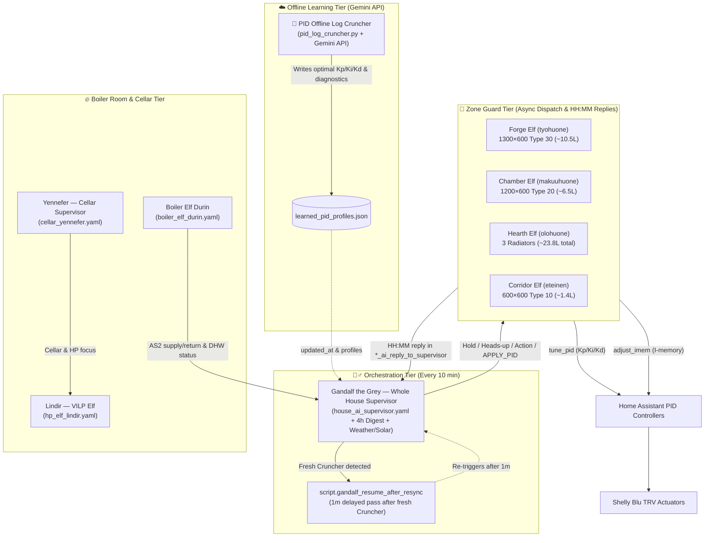

# Middle-Earth Hydronic Heating AI — Multi-Agent PID & MPC Control for a 1958 House

A hierarchical, physics-aware multi-agent heating control architecture running inside **Home Assistant** paired with local **Ollama** inference and **offline cloud log analysis (Gemini API)**. Designed specifically for a 1958 hydronic radiator house with high-mass cast-iron radiators, long hydraulic pipe runs, a 700L buffer tank, two heat pumps (`kone_1` and `pannu_kone2`), and Shelly Blu TRVs.

---

## System Architecture (Z-Axis Hierarchy)

The system separates real-time control loops, 10-minute predictive orchestration, on-demand 26-hour telemetry analysis, and asynchronous offline learning across distinct tiers:



---

## Core Architectural Features

### 1. Reliable Cruncher Sync & Non-Blocking 1m Resync Pass
- **JSON `updated_at` Verification:** Gandalf reads `updated_at` directly from `sensor.pid_learned_profiles` rather than relying solely on Home Assistant's `last_updated` timestamp, avoiding false resync triggers when no new Cruncher batch has been written.
- **Detached 1-Minute Resume Script:** When a fresh Cruncher profile is applied, Gandalf updates `house_ai_last_synced_cruncher_ts`, hands off to `script.gandalf_resume_after_resync`, and releases its `mode: single` lock cleanly before the follow-up pass runs.

### 2. Async Elf Dispatch & `HH:MM`-Timestamped Feedback Loop
- Gandalf dispatches room guards asynchronously without waiting for them to finish, keeping the supervisor cycle fast and predictable.
- Every guard prefixes its `*_ai_reply_to_supervisor` text with `HH:MM ` (`now().strftime('%H:%M')`), ensuring consecutive runs always show a fresh timestamp even when the message text is identical, and Gandalf feeds both the reply text and `last_changed` time into the next cycle's context.

### 3. Lightweight `Hold` Path & Two-Tier Guard Execution
- **`Hold:` / Idle:** Handled lightly without running the 26-hour SQLite/CSV history script or heavy Ollama analysis, reducing compute and I/O load during steady periods.
- **`APPLY_PID:`:** Parses `kp`, `ki`, and `kd` from Gandalf's directive, clamps to safe bounds, and updates the corresponding `input_number` entities directly.
- **`Heads-up:`:** Runs a lightweight Ollama check without loading the 26-hour CSV history.
- **`Action:`:** Loads 26-hour hybrid-resolution telemetry (plus optional `--diag` TRV diagnostics) for full evaluation of `hold`, `adjust_imem`, `tune_pid`, or `calibrate_valve`.

### 4. Segregation of `tune_pid` vs. `adjust_imem`
- **`tune_pid`** updates `Kp`, `Ki`, and `Kd`.
- **`adjust_imem`** updates zone `integral` (I-memory) values—including per-zone I-memories for Living Room (`ruokatila`, `tv_taso`, `paaty`) and 0–100 % I-memory control for Hallway (`eteinen`).

---

## Physical House & Radiator Model

| Zone (Slug) | Guardian | Radiator Inventory & Water Mass | Steady-State Lag | Cold-Start Lag | Key Thermal Characteristics |
| :--- | :--- | :--- | :---: | :---: | :--- |
| **Living Room** (`olohuone`) | Hearth Elf | 3× cast-iron (~23.8 L total: TV 2200×600 T20 ~11.5 L, Dining 1500×600 T20 ~8.5 L, End 2000×600 T10 ~3.8 L) | 5–10 min | 10–15 min | Shared `Kp/Ki/Kd` with 3 independent I-memories; solar & TV-stand heat |
| **Workroom** (`tyohuone`) | Forge Elf | 1× cast-iron 1300×600 Type 30 (~10.5 L) | 20–25 min | 35–40 min | Far end of hydraulic loop; SE window (116°); workstation load; nightly zero-flow calibration |
| **Bedroom** (`makuuhuone`) | Chamber Elf | 1× cast-iron 1200×600 Type 20 (~6.5 L) | 10–15 min | 20–25 min | Sleeping zone target; door/window contact guard; smooth quiet adjustments |
| **Hallway** (`eteinen`) | Corridor Elf | 1× buffer radiator 600×600 Type 10 (~1.4 L) | 5–10 min | 10–15 min | Central corridor; primary control via `imem` (0–100 %) against drafts & swings |
| **Boiler & Cellar** (`as2` / cellar) | Durin, Yennefer & Lindir | 700L buffer tank, Ouman 3-way mix, AS1/AS2 loops, chimney sensor, `kone_1` & `pannu_kone2` | — | — | Central pipe & heat-pump telemetry (`kaasu_in` = hot gas, `kaasu_out` = cold gas) |

---

## Repository Structure

```text
packages/keskimaa/
├── house_ai_supervisor.yaml        # Gandalf supervisor, Cruncher sync & 1m resume script
├── workroom_ai_guard_ollama.yaml   # Forge Elf (workroom guard + HH:MM replies)
├── workroom_zero_flow_calib.yaml   # Nightly zero-flow valve calibration script & schedule
├── bedroom_ai_guard.yaml           # Chamber Elf (bedroom guard + HH:MM replies)
├── livingroom_ai_guard.yaml        # Hearth Elf (3-zone living room guard + HH:MM replies)
├── hallway_ai_guard.yaml           # Corridor Elf (hallway guard + HH:MM replies)
├── boiler_elf_durin.yaml           # Boiler Elf Durin (AS2 supply/return & DHW status)
├── cellar_yennefer.yaml            # Yennefer (cellar supervisor + 4h digest + cruncher trigger)
├── hp_elf_lindir.yaml              # Lindir (heat pump delta-T & gas state monitor)
└── pid_log_cruncher.yaml           # Gemini offline log cruncher scheduler & sensors
```

---

## Safety & Guardrail Mechanisms

- **Dry-Run / Production Toggles:** Supervisors and zone guards can be switched between `DRY-RUN` and `PROD` independently.
- **Clamping & Safe Bounds:** `Kp`, `Ki`, `Kd`, and `I-memory` updates are bounded in templates and output strings are safely truncated (`[:254]`) to fit `input_text` limits.
- **Valve Body vs. Room Air Separation:** Prompts distinguish radiator/valve body temperatures (`valve_temp`, `vt_*`) from room air sensors (`temp`, `ruuvi`, `t_*`).
- **TRV Calibration Protection:** Automated Shelly Blu TRV calibration requires an anomaly, battery ≥ 25 %, and a 48-hour cooldown between calibrations.
