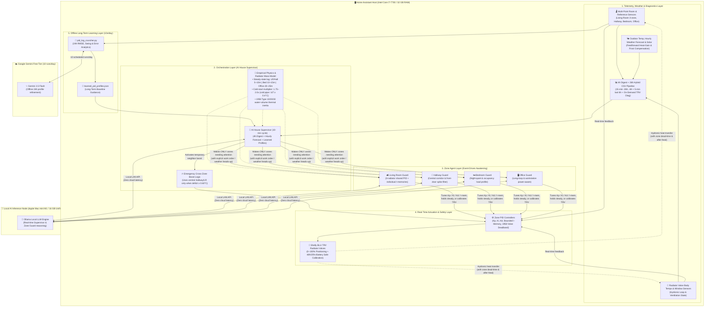

# 🏠 Hierarchical Multi-Agent AI Heating Control (Home Assistant)

An experimental, physics-aware **Building Management System (BMS)** built on top of Home Assistant for a **1958 hydronic radiator house**. Instead of relying on static schedules or basic thermostats, this system combines real-time **PID valve control with mechanical deadband compensation**, **empirically measured thermal lag and radiator water-mass models**, a **hierarchical multi-agent AI supervisor** running on local Apple Silicon inference, and an **offline statistical log cruncher** that continuously refines long-term room profiles.

## 🧠 System & Compute Architecture (Block Diagram)



## ⚙️ Hardware & Compute Topology

* **Core Automation & Telemetry Host (`Intel Core i7-7700` / `32 GB RAM`):** Runs Home Assistant, high-frequency SQLite telemetry queries, hybrid-resolution CSV generators, real-time PID control loops, safety interlocks, and multi-agent orchestration.
* **Local LLM Inference Node (`Apple Mac mini M1` / `16 GB Unified Memory`):** Runs **Ollama** locally on Apple Silicon, handling all real-time inference for the **AI House Supervisor** and all **four Zone Guards** over local LAN with zero cloud dependency and predictable latency.
* **Offline Profile Refinement (`Google Gemini Free Tier`):** A lightweight Python log cruncher (`pid_log_cruncher.py`) runs 10 times per day on pre-aggregated 24-hour statistics (RMSE, temperature swing, error distribution) and physical radiator specs to update `learned_pid_profiles.json` for the Supervisor.

## 🔧 Physical Hydronic Hardware Inventory (1958 Panel Radiators)

The building uses original-era **1958 steel panel radiators (Type 10, 20, and 30 without convector fins)**. Because radiant heat transfer and stored water volume vary dramatically across rooms, each AI agent is explicitly modeled with the physical dimensions, panel count, and estimated water mass of its radiator(s) to anticipate heat-up lag and post-closure after-heat:

| Zone / Radiator | Dimensions & Type | Est. Water Volume | Thermodynamic Behavior & Control Strategy |
| :--- | :--- | :--- | :--- |
| **Living Room – TV** | `2200 × 600 mm` 2-panel (Type 20, behind TV stand) | ~11.5 L | Largest water mass + partially restricted airflow; acts as a smooth, high-inertia base-load carrier (`~27%` steady duty). |
| **Living Room – Dining** | `1500 × 600 mm` 2-panel (Type 20) | ~8.5 L | Strong radiant/convective output in open living space; handles dynamic daytime and solar load shifts. |
| **Living Room – End Wall** | `2000 × 600 mm` 1-panel (Type 10) | ~3.8 L | Wide radiant surface under large end window with low water mass; fast response and minimal after-heat. |
| **Office (Workroom)** | `1300 × 600 mm` 3-panel (Type 30) | ~10.5 L | Highest water-to-room-volume ratio + longest pipe run (`20–25 min` lag); ~10.5 L of hot water releases strong after-heat when PC load (`130–160 W`) starts, requiring strong $K_d$ braking. |
| **Bedroom** | `1200 × 600 mm` 2-panel (Type 20) | ~6.5 L | Radiant-dominant emitter with moderate water inertia; $K_d$ braking prevents overshoot after valve closure. |
| **Hallway** | `600 × 600 mm` 1-panel (Type 10) | ~1.4 L | Compact, low-inertia emitter in central corridor; acts as a steady thermal buffer for adjacent zones. |

## ✨ Key Architectural Highlights

* **Event-Driven Multi-Agent Orchestration with Two-Way Communication:** Every 10 minutes, the **AI House Supervisor** evaluates a compact 4-hour telemetry digest, hourly weather forecasts (`+3h` / `+6h`), solar forecasts, window states, and learned offline profiles. It wakes **only** the Zone Guards facing target drift ($\ge 0.12\ ^\circ\text{C}$), high swing ($\ge 0.22\ ^\circ\text{C}$), valve anomalies, or approaching weather fronts—passing a concise directive (`wake_reason`) and reading each guard's reply (`reply_to_supervisor`) before re-waking.
* **26-Hour Hybrid-Resolution Telemetry Pipeline:** When woken, each Zone Guard receives a custom SQLite-extracted CSV combining **15-minute buckets** (`-26h` to `-6h`) for daily thermal cycles with **5-minute buckets** (`last 6h`) for high-resolution transient tracking, paired with pre-computed 2-hour statistical summaries.
* **Empirical Hydronic Dead-Time & Cold-Start Model:** All agents share a measured physical model of the 1958 hydronic loop:
  * **Steady-State Lag:** Living Room & Hallway `5–10 min`, Bedroom `10–15 min`, Office `20–25 min`.
  * **Cold-Start Multiplier (`1.75–2.0×`):** Applied automatically when valve body temperatures are cold or after setpoint steps $\ge 0.4\ ^\circ\text{C}$, preventing agents from over-tuning while heat is already propagating through the pipes.
* **1958 Valve Mechanical Deadband & On-Demand TRV Diagnostics:** Older cast-iron/steel radiator valves exhibit mechanical stem play and magnetite deposit thresholds (`5–18%` opening before flow starts). Real-time PID loops apply asymmetric deadband mapping (`0%` closed when `pid == 0`, otherwise scaled above deadband), while Zone Guards run on-demand Shelly BLU TRV diagnostics (`trv_diag_helper.py`) and can trigger `calibrate_valve` protected by a **48-hour cooldown** and $\ge 25\%$ **battery safety lock**.
* **Window- & Disturbance-Aware Control:** Contact sensors immediately close TRVs and pause AI interventions during window ventilation (`window_open=True`), while the Hallway Guard filters brief front-door cold spikes and the Office Guard compensates for workstation power load (`power_w`).

## 📈 Measured Control Performance

* **Steady-State Precision ($\pm 0.1\ ^\circ\text{C}$ Target Band):** Maintains multi-sensor living zones (Dining, Sofa, End Wall, and Central Beam reference) tightly within $\pm 0.10\ ^\circ\text{C}$ of the `20.0 °C` setpoint across overnight outdoor swings while distributing steady fractional loads across radiators (`6%`, `7%`, `27%`) without valve hunting.
* **Honest `hold` Discipline:** Guards are explicitly authorized to return `hold` when thermal lag is still settling or stability is within budget, eliminating unnecessary parameter churn.

## 📜 Production System Prompts (Sanitized Examples)

Below are the actual production system prompts used to enforce physical discipline, radiator thermal-mass awareness, weather feedforward, and safe TRV diagnostics.

### 1. AI House Supervisor (Orchestrator Prompt)

```text
ZONE THERMAL LAG TIMES (MEASURED PHYSICS MODEL):
Do not misinterpret slow thermal response as a controller fault before the zone's physical lag time has elapsed:
- Steady-state maintenance (radiator body already warm):
  - Living room & Hallway: 5–10 min from valve opening to room air rise.
  - Bedroom: 10–15 min (gentle thermal rise curve).
  - Office: 20–25 min (long hydraulic loop / lag).
- Cold start (lag x 1.75–2.0): If a radiator has been closed for a long time (low valve body temp) or a large setpoint step (>= 0.4 °C) occurs, true room air lag is 1.75–2.0x longer:
  - Living room & Hallway: 10–15 min | Bedroom: 20–25 min | Office: 35–40 min
- Rule: If the valve is open and valve body temperature (valve_temp) is already rising, wait at least one full zone lag period before making new Kp/Ki changes or requesting cross-heating boost.
- IMPORTANT: Valve body temperature (valve_temp) reflects ONLY the radiator body warming up — it does NOT represent true room air temperature.

RADIATOR HARDWARE & THERMAL MASS (1958 Type 10/20/30 Panel Radiators, no convector fins):
- Living Room (3 radiators): TV 2200x600mm 2-panel (~11.5L water, behind TV stand - carries base load), Dining 1500x600mm 2-panel (~8.5L), End/Paaty 2000x600mm 1-panel (~3.8L, fast response, low after-heat).
- Hallway: 600x600mm 1-panel (~1.4L water, compact central base-load hub).
- Bedroom: 1200x600mm 2-panel (~6.5L water, smooth radiant heat, moderate after-heat).
- Office: 1300x600mm 3-panel (~10.5L water, highest water-to-room-volume ratio + longest pipe run -> slow heat-up, strong post-closure after-heat).

YOUR THREE TASKS:
A) Decide which individual room guards (run_guards) to wake up for deeper 26h PID & TRV analysis (leave stable rooms untouched unless weather feedforward or a valve anomaly warrants a heads-up).
B) Share concise predictive weather/solar context in wake_reason_<room> when a major outdoor temperature shift (>= 3 °C drop or rise over 6h) or strong solar surge (> 250 W) is approaching so local guards can adjust I-memory proactively.
C) Decide whether emergency cross-zone heat boost (boost) via the long central hallway is needed (ONLY if deficit >= 0.60 °C, PID >= 85%, window closed, and delta_1h < +0.10 °C; never boost Bedroom during 20:00–09:00 quiet hours).

RULES FOR TRIGGERING ROOM GUARDS:
- NEVER wake a room guard solely because its window is currently open (window_open=True).
- Wake a guard IF: valve_ok is False, OR error >= 0.12 °C (target +-0.10 °C stability), OR 4h swing >= 0.22 °C, OR avg PID >= 75%, OR major upcoming weather/solar shift.
- READ GUARD REPLIES FIRST: If a guard already replied that it is holding/waiting out thermal lag and conditions have not worsened, DO NOT re-wake it yet.
```

### 2. Zone Guard Prompt Pattern (Example: 3-Zone Living Room & Office)

```text
RADIATOR HARDWARE & THERMAL MASS (1958 Panel Radiators, no convector fins):
- Living Room: TV 2200x600mm 2-panel (~11.5L water, behind TV stand -> base load), Dining 1500x600mm 2-panel (~8.5L), End 2000x600mm 1-panel (~3.8L -> fast response, minimal after-heat).
- Office: 1300x600mm 3-panel (~10.5L water, Type 30 -> massive water volume in a compact room + longest hydronic pipe; prioritize Kd braking and early I-memory reduction against 130–160 W workstation heat load).

EXECUTION ARCHITECTURE & COORDINATION WITH SUPERVISOR:
- You run on demand when woken by the Whole House AI Supervisor. Always inspect the 26h hybrid CSV history (15-min -26h..-6h + 5-min last 6h) to verify when the previous adjustment occurred.
- Choosing action: hold is completely valid and encouraged when stability is within budget or thermal lag is still settling.
- Living Room shares common PID gains (kp, ki, kd) across 3 radiators while tuning individual zone I-memories (imem_dining, imem_tv, imem_end) to handle localized loads (e.g., evening TV heat gain or exterior wall loss).
- Office monitors workstation active power (power_w: ~130–160 W active vs. idle) to adjust I-memory proactively without disturbing well-tuned P/I/D gains.

SHELLY TRV CALIBRATION (action: calibrate_valve):
- ONLY use if on-demand Shelly TRV Diagnostics reports an ANOMALY (e.g., STUCK_CLOSED, STUCK_OPEN, or NO_FLOW_OR_UNCALIBRATED) AND battery is >= 25% (enforced alongside a 48-hour hardware cooldown lock).
```
