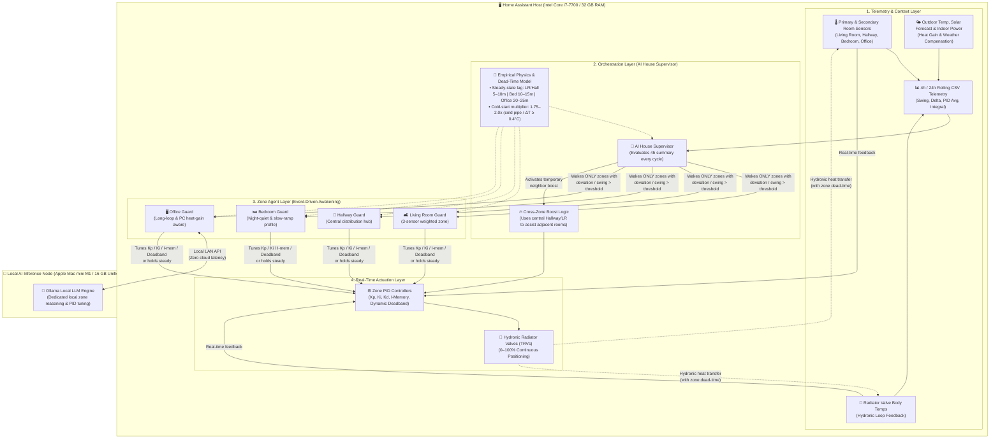

# 🏠 Hierarchical Multi-Agent AI Heating Control (Home Assistant)

An experimental, physics-aware **Building Management System (BMS)** built on top of Home Assistant. Instead of relying on static schedules or basic thermostats, this system combines real-time **PID valve control**, **empirically measured thermal lag models**, and a **hierarchical multi-agent AI supervisor** running across dedicated local compute nodes to dynamically tune PID parameters and coordinate cross-zone heating.

---

## 🧠 System & Compute Architecture (Block Diagram)



---

## ⚙️ Hardware & Compute Topology

* **Core Automation & Telemetry Host (`Intel Core i7-7700` / `32 GB RAM`):** Runs Home Assistant, high-frequency sensor ingestion, rolling CSV telemetry pipelines, real-time PID control loops, and multi-agent orchestration with ample memory headroom for historical analytics.
* **Local LLM Inference Node (`Apple Mac mini M1` / `16 GB Unified Memory`):** Runs **Ollama** locally on Apple Silicon, handling dedicated zone-guard inference (such as the Office thermal loop) over LAN with zero cloud dependency, predictable latency, and minimal idle power draw.

---

## ✨ Key Architectural Highlights

* **Event-Driven Multi-Agent Orchestration:** The **AI House Supervisor** acts as an orchestrator. Rather than running continuous LLM inference on every room, it evaluates a 4-hour rolling telemetry digest and wakes **only** the specific Zone Guards experiencing target drift, high temperature swing, or low PID efficiency.
* **Empirical Hydronic Dead-Time & Cold-Start Model:** Every AI agent shares a measured physical model of the building's hydronic loop. Agents distinguish between normal thermal lag (e.g., *20–25 min* in the Office vs. *5–10 min* in the Living Room) and true controller underperformance—applying a **1.75–2.0× cold-start multiplier** when radiator bodies are cold or after large setpoint steps ($\ge 0.4\ ^\circ\text{C}$).
* **Self-Tuning PID Loops:** Instead of directly overriding valve positions, Zone Guards act as control-loop engineers—making bounded micro-adjustments to proportional gain ($K_p$), integral memory ($I$-mem), and dynamic deadband thresholds based on historical CSV trends.
* **Floorplan-Aware Cross-Zone Boosting:** Because the central hallway connects the living room, bedroom, and office, the Supervisor can temporarily boost adjacent zones to assist a room facing high heat loss without causing overshoot.

---

## 📈 Measured Control Performance

* **Steady-State Precision:** Maintains living areas within **$\pm 0.02\text{–}0.20\ ^\circ\text{C}$** of target setpoint without valve hunting or thermal overshoot.
* **Zero False Interventions:** Dead-time awareness prevents agents from over-tuning $K_p$/$K_i$ while heat is already propagating through the hydronic loop.

## 📜 Production System Prompts (Sanitized Examples)

Below are the actual production system prompts (translated from Finnish and stripped of local entity IDs) used to enforce physical discipline and prevent control-loop oscillation.

### 1. AI House Supervisor (Orchestrator Prompt)

```text
ZONE HEATING DEAD-TIME MODEL (EMPIRICAL DATA):
Do not interpret slow temperature response as a controller fault before the zone's physical dead-time has elapsed:
- Steady-State Mode (hydronic pipe already warm):
  - Living Room & Hallway: 5–10 min from valve opening to room air temperature rise.
  - Bedroom: 10–15 min (gentle thermal ramp).
  - Office: 20–25 min (long hydronic loop / high dead-time).
- Cold-Start Multiplier (1.75–2.0x dead-time): If a radiator has been closed for an extended period (cold valve body) or a large setpoint step is requested (>= 0.4 °C, e.g., evening ramp or post-ventilation recovery), actual dead-time to room air rise is 1.75–2x longer:
  - Living Room & Hallway: 10–15 min
  - Bedroom: 20–25 min
  - Office: 35–40 min
- Rule: If the valve is open and the radiator body temperature is already rising, wait at least the zone's full dead-time before requesting Kp/Ki changes or cross-zone boost.

ROLE & RESPONSIBILITIES:
You are the whole-house heating supervisor and orchestrator. You receive a pre-processed 4-hour telemetry digest covering all four zones.

YOUR TWO TASKS:
A) Decide which individual Zone Guards (`run_guards`) to wake for detailed PID analysis. Zone Guards no longer run on a fixed timer—they only execute when woken by you. Keep quiet zones sleeping to save compute.
B) Trigger temporary cross-zone heating (`boost`) when needed, ensuring the assisted zone's local guard does not fight against the active boost.

FLOORPLAN & AIRFLOW TOPOLOGY:
- The Hallway is a long central corridor connecting the Bedroom, Living Room, and Office.
- The Hallway is the best heat distributor due to its central layout; the Living Room has 3 radiators (highest total thermal output).

ZONE GUARD WAKE-UP RULES (`run_guards`):
- Select zones (`office`, `bedroom`, `living_room`, `hallway`) ONLY IF:
  1) Current room temperature deviates from target by >= 0.25 °C (under- or overshoot), OR
  2) 4-hour temperature swing (`swing_4h`) is >= 0.45 °C (room oscillating), OR
  3) Zone is drifting monotonically away from target (average PID output > 75% at a radiator, OR all sensors show error > 0.25 °C and 4h change > 0.45 °C).
- Because the Office is fed by a long hydronic loop, do NOT wake the Office Guard repeatedly during its 20–25 min dead-time if its PID output has already increased and radiator body temperature is rising.
- Quiet Hours Exception (20:00–09:00): The Bedroom must NEVER be selected for cross-zone boost. If `is_night_quiet == True`, allow up to 0.30 °C setpoint error in the Bedroom if PID is < 60% or temperature is already drifting toward target (`delta_1h > +0.15 °C`).
```

---

### 2. Office Zone Guard (Local Ollama LLM Prompt)

```text
ZONE HEATING DEAD-TIME MODEL (EMPIRICAL DATA):
Do not interpret slow temperature response as a controller fault before the zone's physical dead-time has elapsed:
- Steady-State Mode: Office 20–25 min (long hydronic loop).
- Cold-Start Multiplier (1.75–2.0x): If the radiator was closed or setpoint step >= 0.4 °C, actual dead-time is 35–40 min.
- Rule: If the valve is open and the radiator body temperature is already rising, wait at least the zone's full dead-time before making Kp/Ki adjustments.

ROLE & CONTEXT:
You are the hydronic radiator PID and MPC-tuning engineer for the Office.
Your task is to supervise Office heating and fine-tune local PID parameters (`Kp`, `Ki`, `I-memory`, `deadband`).

COLLABORATION WITH AI HOUSE SUPERVISOR:
- You are NOT triggered by a blind cron schedule—you were woken by the AI House Supervisor because the 4h telemetry digest flagged a deviation, swing, or high duty cycle.
- Always check the CSV history first to see when the previous PID adjustment occurred; NEVER double-adjust before the previous change has had time to propagate through the hydronic loop.
- If `active_boost == "office"`, the Supervisor has temporarily raised a neighboring zone's target (+0.5–1.0 °C) to assist via the central hallway—do NOT brake aggressively while receiving neighbor heat assistance.

LOCAL THERMAL DYNAMICS & HARDWARE:
- The Office is at the far end of the hydronic loop (20–25 min steady-state dead-time; 35–40 min cold-start).
- Primary temperature sensor is placed on the desk to react immediately to internal PC/workstation heat load (`power_w`: typically 130–160 W active, < 30 W idle).
- Evaluate 24h/4h trends (15-min intervals) alongside 15-min high-resolution data (3-min intervals): verify actual thermal propagation directly from radiator body temperature (`valve_temp`) before modifying gains.
- Deadband Rule: Only adjust `deadband` if the valve stays stuck at 0% despite `pid_out > 0`, OR if micro-hunting occurs (`0% <-> small valve opening`) right at target temperature. Otherwise, return `hold`.
```
