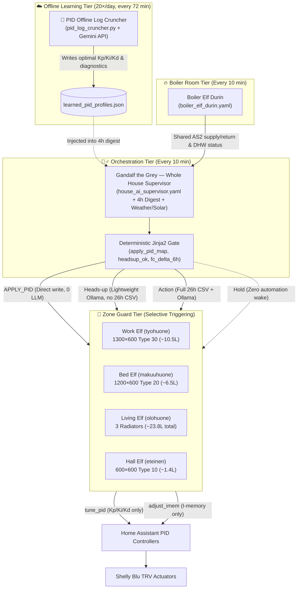

# Middle-Earth Hydronic Heating AI — Multi-Agent PID & MPC Control for a 1958 House

A hierarchical, physics-aware multi-agent heating control architecture running inside **Home Assistant** on a **Mac mini M1** (local **Ollama** inference) paired with **20×/day offline cloud log analysis (Gemini API)**. Designed specifically for a 1958 hydronic radiator house with high-mass cast-iron radiators, long hydraulic pipe runs, and Shelly Blu TRVs.

---

## System Architecture (Z-Axis Hierarchy)

The system separates real-time control loops, 10-minute predictive orchestration, on-demand 26-hour telemetry analysis, and asynchronous 24-hour offline learning across four distinct tiers:



---

## Core Architectural Features

### 1. Deterministic Jinja2 Pre-Computation & Zero-Wake `Hold`
To eliminate floating-point hallucination in local LLM prompts and avoid unnecessary M1 CPU/GPU load:
- **Zero-Wake `Hold`:** When a zone is within deadband or warming steadily (`Hold:`), the Supervisor leaves the room's automation completely untriggered—saving ~32 seconds of polling delays per 10-minute cycle and preserving the guard's last real status message.
- **Deterministic `APPLY_PID` Gate:** Before calling Ollama, Jinja2 compares `learned_pid_profiles.json` against active production gains (`|dKp| >= 0.20`, `|dKi| >= 0.02`, or `|dKd| >= 0.10`) and verifies a mandatory **45-minute cooldown** via `last_changed` timestamps. Matching zones receive a deterministic `APPLY_PID` directive that writes gains directly without invoking a local LLM.
- **Deterministic Weather `Heads-up` Gate:** 6-hour outdoor temperature deltas (`fc_delta_6h`) and 1-hour solar forecasts (`solar_1h`) are evaluated in Jinja2 against tunable thresholds (`input_number.supervisor_headsup_temp_delta` = 3.0 °C, `input_number.supervisor_headsup_solar_w` = 250 W). Any false-positive `Heads-up` generated by the LLM is automatically downgraded to `Hold` before reaching the zone guard.

### 2. Two-Tier Zone Guard Execution (Lightweight vs. Full 26h CSV)
Each zone guard supports four distinct execution paths depending on Gandalf's structured heartbeat prefix:
1. **`Hold:` / Idle:** Bypassed completely at the Supervisor level (or acknowledged lightly in <1s without SQLite/LLM calls).
2. **`APPLY_PID:`:** Parses `kp`, `ki`, `kd` via regex, clamps values to safe bounds, writes directly to `input_number.<room>_kp/ki/kd`, and exits without invoking Ollama[cite: 5, 7, 9, 11].
3. **`Heads-up:`:** Skips the 26-hour SQLite CSV extraction entirely and runs a lightweight Ollama prompt restricted strictly to `hold` or `adjust_imem` (±1.5–3.0 % feedforward for approaching frost or solar gain).
4. **`Action:`:** Extracts 26 hours of hybrid-resolution telemetry (15-min intervals for `-26h..-6h`, 5-min intervals for the last `6h`) plus optional on-demand Shelly TRV diagnostics (`--diag`) for full PID/I-memory/calibration analysis[cite: 5, 7, 9, 11].

### 3. Strict Segregation of `tune_pid` vs. `adjust_imem`
To prevent local I-memory feedforward adjustments from accidentally overwriting offline-learned PID gains:
- **`tune_pid`** writes **only** `Kp`, `Ki`, and `Kd`.
- **`adjust_imem`** writes **only** zone `integral` (I-memory) values (including independent per-radiator I-memories for Living Room's Dining, TV Console, and End Wall zones)[cite: 7].

---

## Physical House & Radiator Model

| Zone (Slug) | Guardian | Radiator Inventory & Water Mass | Steady-State Lag | Cold-Start Lag | Key Thermal Characteristics |
| :--- | :--- | :--- | :---: | :---: | :--- |
| **Living Room** (`olohuone`) | Living Elf | 3× cast-iron (~23.8 L total: TV 2200×600 T20 ~11.5 L, Dining 1500×600 T20 ~8.5 L, End 2000×600 T10 ~3.8 L)[cite: 4, 7] | 5–10 min[cite: 4, 7] | 10–15 min (or ~45 min after >45 min full closure)[cite: 4, 7] | High thermal inertia; shared `Kp/Ki/Kd` with 3 independent I-memories[cite: 7] |
| **Workroom** (`tyohuone`) | Work Elf | 1× cast-iron 1300×600 Type 30 (~10.5 L)[cite: 4, 5] | 20–25 min[cite: 4, 5] | 35–40 min[cite: 4, 5] | Far end of hydraulic loop; SE window (116°); workstation waste heat (~130–160 W)[cite: 5] |
| **Bedroom** (`makuuhuone`) | Bed Elf | 1× cast-iron 1200×600 Type 20 (~6.5 L)[cite: 4, 11] | 10–15 min[cite: 4, 11] | 20–25 min[cite: 4, 11] | Sleeping target 18.0 °C; overnight occupancy load (~120–160 W); night quiet 20:00–09:00[cite: 4, 11] |
| **Hallway** (`eteinen`) | Hall Elf | 1× buffer radiator 600×600 Type 10 (~1.4 L)[cite: 4, 9] | 5–10 min[cite: 4, 9] | 10–15 min[cite: 4, 9] | Central heat distribution corridor; filters brief front-door drafts[cite: 4, 9] |
| **Boiler Room** (`as2`) | Boiler Elf Durin | Central main loop (`AS2 meno/paluu`) & DHW tank (`LKV varaaja`)[cite: 10] | — | — | Only place with supply/return pipe sensors; rooms only measure TRV valve body temps[cite: 4, 10] |

---

## Repository Structure

```text
├── packages/
│   ├── house_ai_supervisor.yaml        # Gandalf supervisor, deterministic gates, master targets[cite: 4]
│   ├── workroom_ai_guard_ollama.yaml   # Work Elf (single zone + workstation power)[cite: 5]
│   ├── bedroom_ai_guard.yaml           # Bed Elf (single zone + window/occupancy)[cite: 11]
│   ├── livingroom_ai_guard.yaml        # Living Elf (3 radiators, shared PID, 3 I-memories)[cite: 7]
│   ├── hallway_ai_guard.yaml           # Hall Elf (central corridor + front-door filter)[cite: 9]
│   ├── boiler_elf_durin.yaml           # Main hydronic loop & DHW sensor aggregator[cite: 10]
│   └── pid_log_cruncher.yaml           # 20×/day Gemini offline log analysis scheduler[cite: 6]
└── scripts/
    ├── house_4h_digest.py              # Compiles 4h zone stats, valve anomalies & learned profiles
    ├── pid_log_cruncher.py             # Offline Gemini API telemetry analyzer
    ├── workroom_ai_data.py             # 26h hybrid CSV builder + TRV diagnostics
    ├── bedroom_ai_data.py              # 26h hybrid CSV builder + TRV diagnostics
    ├── livingroom_ai_data.py           # 26h 3-zone hybrid CSV builder + TRV diagnostics
    └── hallway_ai_data.py              # 26h hybrid CSV builder + TRV diagnostics
```

---

## Safety & Guardrail Mechanisms

- **Dry-Run / Production Toggle per Agent:** Every agent (`house_ai_supervisor_active`, `workroom_ai_guard_production`, `bedroom_ai_guard_production`, `livingroom_ai_guard_production`, `hallway_ai_guard_production`) can be toggled independently between `DRY-RUN` (logs proposed changes) and `PROD` (writes live setpoints/gains)[cite: 4, 5, 7, 9, 11].
- **Strict Parameter Clamping:** All PID gains and I-memory updates are bounded in Jinja2 (`Kp`: 1.5–12.0, `Ki`: 0.05–1.0, `Kd`: 0.0–5.0, `I-memory`: ±4.0 % per step, 0–60 % total)[cite: 5, 7, 9, 11].
- **Valve Body vs. Room Air Separation:** Prompts explicitly enforce reading room air temperature exclusively from wall/desk sensors (`temp` / `ruuvi` / `t_*`) while treating TRV `valve_temp` strictly as a hydraulic flow indicator[cite: 4, 5, 7, 9, 11].
- **TRV Calibration Protection:** Automated Shelly Blu TRV calibration (`button.*_calibrate`) requires a confirmed diagnostic anomaly, battery level ≥ 25 %, and a minimum 48-hour cooldown since the last calibration[cite: 5, 7, 9, 11].
