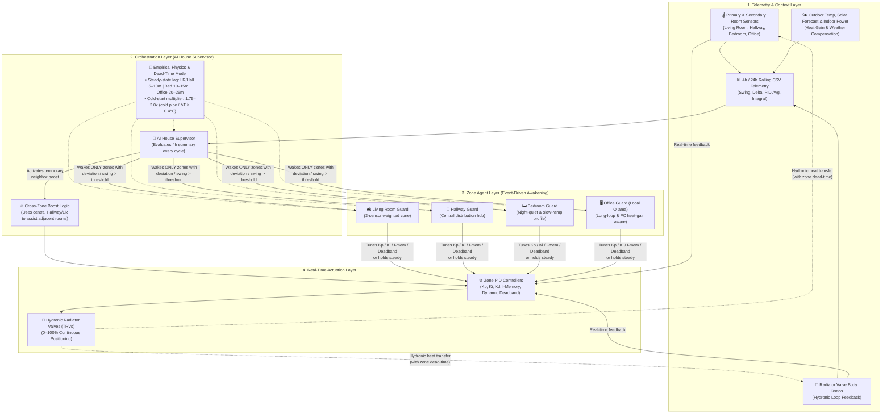

# 🏠 Hierarchical Multi-Agent AI Heating Control (Home Assistant)

An experimental, physics-aware **Building Management System (BMS)** built on top of Home Assistant. Instead of relying on static schedules or basic thermostats, this system combines real-time **PID valve control**, **empirically measured thermal lag models**, and a **hierarchical multi-agent AI supervisor** that dynamically tunes PID parameters and coordinates cross-zone heating.

---

## 🧠 System Architecture (Block Diagram)

---

## ✨ Key Architectural Highlights

* **Event-Driven Multi-Agent Orchestration:** The **AI House Supervisor** acts as an orchestrator. Rather than running expensive LLM inference on every room continuously, it evaluates a 4-hour rolling telemetry digest and wakes **only** the specific Zone Guards experiencing target drift, high temperature swing, or low PID efficiency.
* **Empirical Hydronic Dead-Time & Cold-Start Model:** Every AI agent shares a measured physical model of the building's hydronic loop. Agents distinguish between normal thermal lag (e.g., *20–25 min* in the Office vs. *5–10 min* in the Living Room) and true controller underperformance—applying a **1.75–2.0× cold-start multiplier** when radiator bodies are cold or after large setpoint steps ($\ge 0.4\ ^\circ\text{C}$).
* **Self-Tuning PID Loops:** Instead of directly overriding valve positions, Zone Guards act as control-loop engineers—making bounded micro-adjustments to proportional gain ($K_p$), integral memory ($I$-mem), and dynamic deadband thresholds based on historical CSV trends.
* **Floorplan-Aware Cross-Zone Boosting:** Because the central hallway connects the living room, bedroom, and office, the Supervisor can temporarily boost adjacent zones to assist a room facing high heat loss without causing overshoot.
* **Hybrid Cloud + Local LLM Execution:** Combines cloud reasoning for house-wide orchestration with local **Ollama** inference for dedicated zone control.

---

## 📈 Measured Control Performance

* **Steady-State Precision:** Maintains living areas within **$\pm 0.02\text{–}0.20\ ^\circ\text{C}$** of target setpoint without valve hunting or thermal overshoot.
* **Zero False Interventions:** Dead-time awareness prevents agents from over-tuning $K_p$/$K_i$ while heat is already propagating through the hydronic loop.
